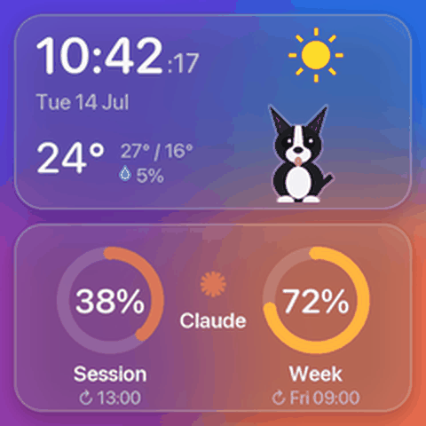

# SmallTV Live

Open firmware that turns the GeekMagic SmallTV-Ultra into a live Wi-Fi display, with a host app that renders a clock, the weather and your Claude plan usage and streams it to the screen.

<p align="center"></p>

## Features

- **Live screen at about 10 frames per second.** The host renders every frame and sends only the parts that changed. The clock ticks every second and nothing is ever written to the TV's flash while it runs.
- **Clock and date** with seconds, in English or Romanian.
- **Weather** from [Open-Meteo](https://open-meteo.com) (no API key): temperature, high and low, chance of rain and an icon for the current conditions.
- **A Boston terrier** that follows the weather: it hops around in the sun, sits and wags when it's partly cloudy, curls up when it's overcast and sleeps through rain, snow and storms.
- **Claude usage**: the five-hour session and weekly limits as rings with their reset times, taken from the data Claude Code passes to its status line.
- **Safe to try.** The firmware keeps the stock flash layout and never touches the stock file system, so the original GeekMagic firmware can be put back at any time from the TV's own update page.
- Night brightness, frosted glass cards, smooth dithered colour.

## How it works

```
 ┌──────────── host (Mac or Linux) ────────────┐            ┌──── SmallTV-Ultra ────┐
 │ weather (Open-Meteo)   Claude Code status   │            │  SmallTV Live firmware │
 │            \              line cache        │  TCP 7777  │                        │
 │             render 240x240 frame ──► diff ───┼───────────►│  rectangles ──► panel  │
 │                                    RGB565    │◄───────────│  'K' per frame         │
 └──────────────────────────────────────────────┘            └────────────────────────┘
```

The firmware is a small Wi-Fi display server: it receives rectangles of RGB565 pixels and writes them straight to the ST7789 panel. All drawing happens on the host, so the screen can show anything without reflashing. The wire format is described in [docs/protocol.md](docs/protocol.md).

## Hardware

| | |
|---|---|
| Device | GeekMagic SmallTV-Ultra (stock firmware `Ultra-V9.0.x`) |
| Module | ESP-12F (ESP8266), 4 MB flash |
| Display | 1.54" 240x240 IPS, ST7789 |

Other SmallTV models use different hardware or flash layouts and are not supported. Pins and the flash layout are documented in [docs/hardware.md](docs/hardware.md).

## Install the firmware

1. **Get the image.** Download `smalltv-live-firmware.bin` from the [releases](../../releases), or build it:

   ```sh
   pip install platformio
   cd firmware && pio run
   # .pio/build/ultra/firmware.bin
   ```

2. **Flash it from the stock web page.** Open `http://<tv-ip>/update` (the IP is shown on the TV), choose the file and press **Update**. The TV restarts after a few seconds. No cable or opening the case is needed.

3. **Wi-Fi.** The firmware joins the network the stock firmware was using. If it can't, it opens an open access point called **SmallTV-Live**: join it from your phone, browse to `http://192.168.4.1/wifi`, pick your 2.4 GHz network and enter its password.

While no host is connected, the TV shows its IP address between two bars: green when it's on your network, amber in setup mode. Its status page is at `http://<tv-ip>/` and it also answers to `smalltv.local`.

### Changing the Wi-Fi network

No flashing or computer needed:

- **The old network is gone** (new router, moved house): power the TV on. After 30 seconds without its network it shows amber bars and opens **SmallTV-Live**. Join it from your phone, open `http://192.168.4.1/wifi` and choose the new network.
- **The old network still works and you want to switch:** unplug the TV and plug it back in, then within 10 minutes open `http://<tv-ip>/wifi` from a device on the current network.
- **After a power cut** the TV may start before your router and fall back to setup mode. It keeps trying the saved network every two minutes and returns to normal on its own once the router is back.

If the TV can't join the network you entered, it opens SmallTV-Live again after 30 seconds so you can correct it.

## Install the host

### macOS

Requires Python 3.11 or newer and the Xcode command line tools (`xcode-select --install`).

```sh
git clone https://github.com/synack1337/smalltv-live.git
cd smalltv-live
./macos/install.sh
```

This creates a Python environment, a small **SmallTV Live** app in `~/Applications` and a login agent that keeps it running. Then:

1. Edit `~/.config/smalltv-live/config.toml`: the TV's address, your location for the weather and the language (see [config.example.toml](config.example.toml)).
2. On first start macOS asks to let **SmallTV Live** find devices on your local network. Allow it. If you missed the prompt, turn it on in **System Settings > Privacy & Security > Local Network**.

The log is in `~/Library/Logs/SmallTV Live.log`. To remove everything except your config, run `./macos/uninstall.sh`.

### Linux

```sh
python3 -m venv ~/.local/share/smalltv-live
~/.local/share/smalltv-live/bin/pip install -r host/requirements.txt ./host
~/.local/share/smalltv-live/bin/smalltv-live run
```

A systemd user unit is in [docs/linux.md](docs/linux.md).

### Try it without a TV

```sh
smalltv-live preview screen.png
```

renders one frame with your config.

## Claude usage

Claude Code passes a JSON object to the [status line](https://docs.claude.com/en/docs/claude-code/statusline) command, including your plan's `rate_limits`. `smalltv-live statusline` stores just those percentages and reset times in `~/.claude/rate_limits.json` (mode 0600), which the screen reads. It reads no credentials and sends nothing anywhere.

Add it to `~/.claude/settings.json`:

```json
{
  "statusLine": {
    "type": "command",
    "command": "\"$HOME/Library/Application Support/SmallTV Live/venv/bin/smalltv-live\" statusline",
    "refreshInterval": 30
  }
}
```

If you already have a status line, keep it by passing it with `--then`, for example `... statusline --then "/path/to/your-statusline.sh"`. Its output is shown unchanged. The command is run directly, without a shell, so put pipelines in a script.

The numbers refresh while a Claude Code session is open. If they are older than 20 minutes, the rings turn grey and the screen says how old they are.

## Configuration

All settings live in `~/.config/smalltv-live/config.toml` (or the file given with `--config` or `$SMALLTV_LIVE_CONFIG`). Every key is optional; [config.example.toml](config.example.toml) lists them all with their defaults. Weather is shown only when you set a latitude and longitude.

If colours look wrong on your unit, set `panel.invert` or `panel.bgr`; the host sends them to the TV on every connect.

## Going back to the stock firmware

The stock file system (GeekMagic's web pages, settings and photos) is never touched, so restoring is one upload:

1. Download the Ultra firmware from [GeekMagicClock/smalltv-ultra](https://github.com/GeekMagicClock/smalltv-ultra) and check its MD5.
2. Unplug the TV and plug it back in. Firmware uploads are only accepted in the first 10 minutes after power-on.
3. Open `http://<tv-ip>/update`, choose the `.bin` and press **Update**.

Recovery over the serial header and other details are in [docs/recovery.md](docs/recovery.md).

## Security

The firmware is meant for a home network you trust. The stream port and the status page have no authentication, firmware uploads are only accepted for 10 minutes after power-on, and Wi-Fi settings can only be changed in setup mode. See [docs/security.md](docs/security.md) for the details and [SECURITY.md](SECURITY.md) to report a vulnerability.

## Development

```sh
cd host && python -m unittest discover -s tests -t .     # host tests
cd firmware && pio run                                    # firmware build
```

CI runs both on every push. See [CHANGELOG.md](CHANGELOG.md) for releases.

## Credits

- Pin map and panel settings: the [ESPHome device page](https://devices.esphome.io/devices/geekmagic-ultra/) and [smalltv-mod](https://github.com/giovi321/smalltv-mod), whose notes on the Ultra's stock flash layout made a one-step install possible.
- Stock firmware: [GeekMagicClock/smalltv-ultra](https://github.com/GeekMagicClock/smalltv-ultra).
- Weather data: [Open-Meteo](https://open-meteo.com) (CC BY 4.0).

## License

GPL-3.0-or-later, see [LICENSE](LICENSE).

This project is not affiliated with GeekMagic or Anthropic. Claude is a trademark of Anthropic.
